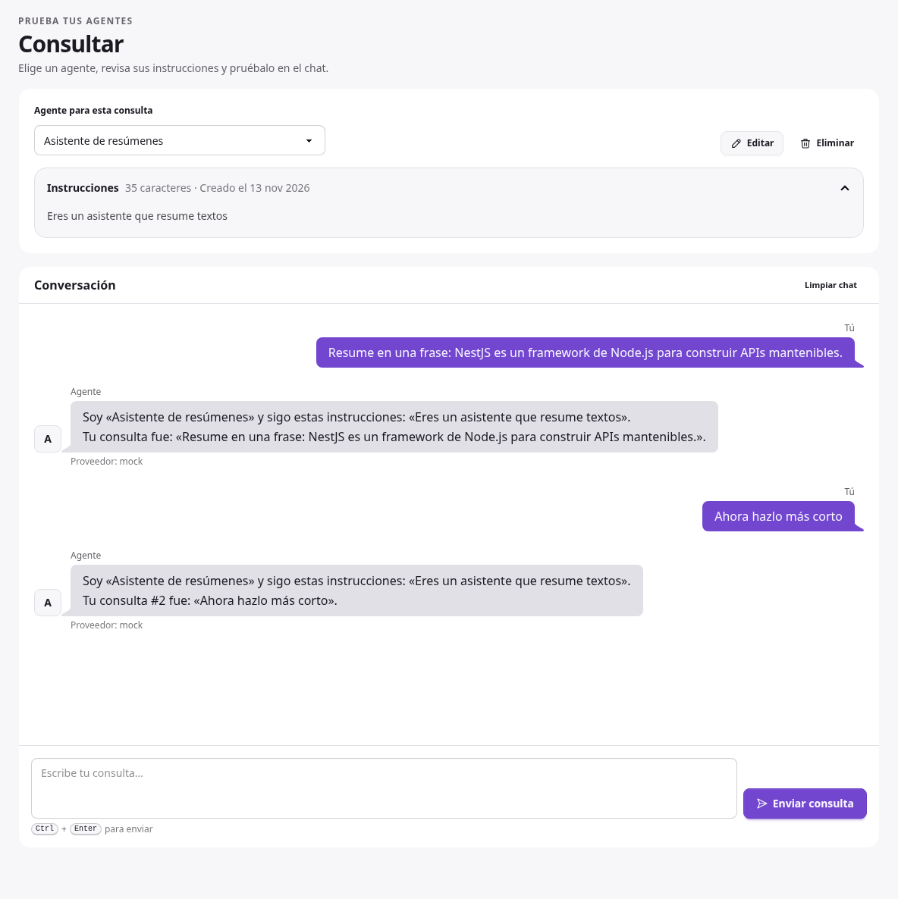
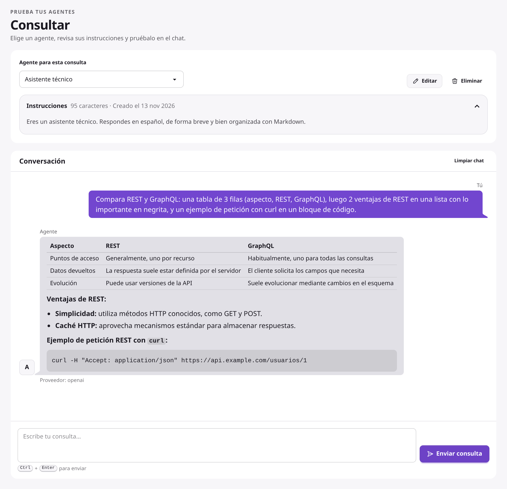
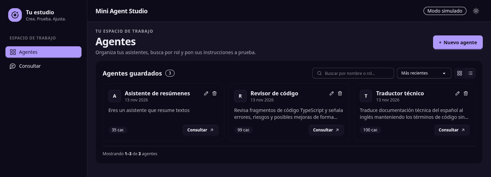
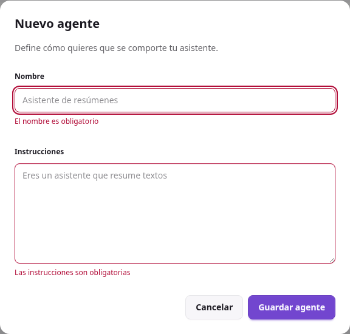
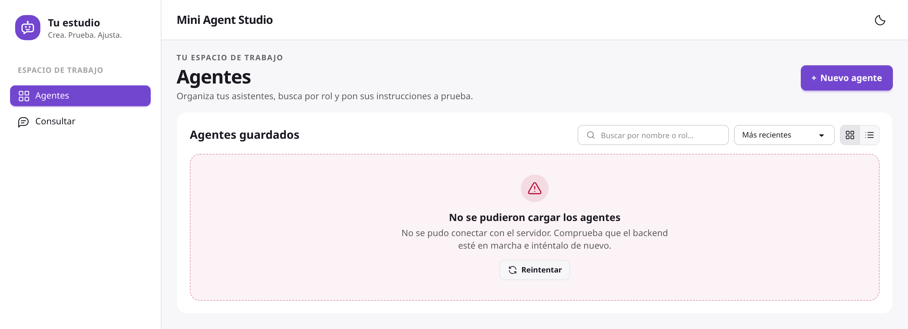
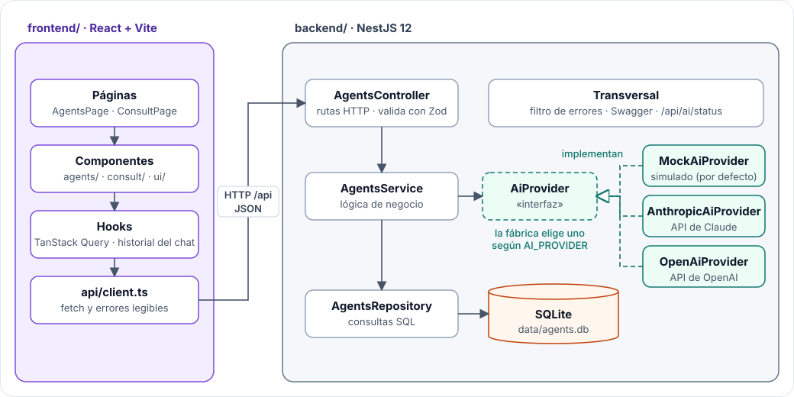

# Mini Agent Studio

Aplicación web local para crear agentes de IA, guardarlos, seleccionarlos y enviarles
consultas. Un agente es un nombre y unas instrucciones (por ejemplo, "Eres un asistente
que resume textos"). Funciona sin API key, sin costo y sin conexión a internet gracias a
un proveedor de IA simulado (modo mock).

Prueba técnica Fullstack.



## Contenido

| Sección | Qué encontrarás |
| --- | --- |
| [Instalación y ejecución](#instalación-y-ejecución) | Requisitos, pasos desde un clon limpio (con npm o con Docker), variables de entorno e IA real opcional con Claude u OpenAI |
| [Demostración del flujo](#demostración-del-flujo) | Crear → seleccionar → consultar → ver la respuesta, con capturas |
| [Arquitectura](#arquitectura) | Estructura del proyecto, diagrama de componentes y flujo de una consulta |
| [Endpoints](#endpoints) | Rutas de la API, ejemplos de solicitud y respuesta, y formato de errores |
| [Pruebas](#pruebas) | Pruebas automatizadas del backend |
| [Tecnologías y razones](#tecnologías-y-razones) | Qué se eligió y por qué |
| [Limitaciones conocidas](#limitaciones-conocidas) y [mejoras](#mejoras-con-más-tiempo) | Lo que falta y dos mejoras con más tiempo |
| [Uso de IA](#uso-de-ia) | Herramientas, prompts y verificación (`AI_USAGE.md`) |

## Instalación y ejecución

### Requisitos

- **Node.js 24 o superior** (probado desde un clon limpio con 24.22.3 y 26.13.1; `.nvmrc`
  fija la 26.13.1). El backend usa el módulo `node:sqlite` integrado en Node, así que no
  hay que instalar ninguna base de datos.
- npm (incluido con Node).
- Solo para la vía con Docker (opcional): Docker con **Compose 2.24 o superior**, que es la
  versión que admite el `.env` opcional (`required: false`). Probado con Compose 5.6.

### Pasos

**1. Clonar el repositorio**

```bash
git clone https://github.com/YouRobla/mini-agent-studio.git
cd mini-agent-studio
```

**2. Backend** (primera terminal). Queda en `http://localhost:3000/api`, con la
documentación interactiva en `http://localhost:3000/api/docs`.

```bash
cd backend
npm install
npm run start
```

**3. Frontend** (segunda terminal, desde la raíz del repositorio). Queda en
`http://localhost:5173`.

```bash
cd frontend
npm install
npm run dev
```

**4. Abrir** `http://localhost:5173` en el navegador.

Si el puerto 5173 está ocupado, Vite usa el siguiente (5174…) y lo indica en la terminal.
La aplicación funciona igual, porque el navegador pide la API al propio Vite (`/api`) y
Vite la reenvía al backend.

No hace falta crear ningún archivo `.env`: todos los valores tienen un valor por defecto.
La base de datos se crea sola en `backend/data/agents.db` en el primer arranque.

### Con Docker (opcional)

Una segunda vía que no necesita Node instalado, solo Docker con Compose. No hace falta
crear ningún archivo antes:

```bash
git clone https://github.com/YouRobla/mini-agent-studio.git
cd mini-agent-studio
docker compose up --build
```

Abre `http://localhost:8080`. La API y su documentación quedan en el mismo puerto:
`http://localhost:8080/api` y `http://localhost:8080/api/docs`.

| Cómo se arranca | Página | API y Swagger |
| --- | --- | --- |
| `npm run dev` + `npm run start` | `http://localhost:5173` | `http://localhost:3000/api` y `/api/docs` |
| `docker compose up --build` | `http://localhost:8080` | `http://localhost:8080/api` y `/api/docs` |

**Cómo está montado:** dos contenedores, cada uno con su `Dockerfile` en su carpeta.

```
Navegador ──► :8080 [ frontend: nginx ] ── /api ──► [ backend: NestJS ] ──► volumen agents-data
                    archivos de React                 la API (no se publica)   (agents.db)
```

- **`frontend`:** Node compila React y la imagen final es solo nginx sirviendo esos
  archivos (`frontend/nginx.conf`). nginx reenvía `/api` al contenedor `backend` por su
  nombre, así que la página y la API comparten origen y no hay CORS (el mismo papel que el
  proxy de Vite en desarrollo). Usa `nginx-unprivileged`, la variante oficial que no corre
  como root.
- **`backend`:** NestJS compilado, solo con las dependencias de producción y como usuario
  sin privilegios. No se publica fuera: solo lo alcanza el frontend.
- **Datos:** la base SQLite vive en el volumen `agents-data`, así que los agentes
  sobreviven a reiniciar o reconstruir los contenedores.
- **Salud:** el compose comprueba los dos servicios, y el frontend espera a que el
  backend responda antes de arrancar.

**IA real con Docker:** `backend/.env` es opcional. Si existe, Compose pasa sus variables
(`AI_PROVIDER` y la clave) al contenedor al arrancarlo; si no, modo simulado. La clave no
se copia dentro de la imagen.

| Quiero… | Comando |
| --- | --- |
| Arrancar (y reconstruir si cambió el código) | `docker compose up --build` |
| Aplicar un cambio en `backend/.env` | `docker compose up -d` (recrea el backend con las variables nuevas, sin reconstruir) |
| Ver los registros del backend | `docker compose logs -f backend` |
| Parar sin perder los agentes | `docker compose down` |
| Parar y borrar los agentes | `docker compose down -v` |

### Variables de entorno (opcionales)

| Variable | Dónde | Valor por defecto | Para qué |
| --- | --- | --- | --- |
| `PORT` | backend | `3000` | Puerto de la API |
| `CORS_ORIGIN` | backend | `http://localhost:5173` | Origen permitido si el navegador llama al backend directamente (`VITE_API_URL`) |
| `DATABASE_PATH` | backend | `backend/data/agents.db` | Ruta del archivo SQLite |
| `AI_PROVIDER` | backend | `mock` | Proveedor de IA: `mock` (simulado), `anthropic` (Claude) u `openai` |
| `ANTHROPIC_API_KEY` | backend | — | Clave de la API de Claude; obligatoria con `AI_PROVIDER=anthropic` |
| `OPENAI_API_KEY` | backend | — | Clave de la API de OpenAI; obligatoria con `AI_PROVIDER=openai` |
| `AI_MODEL` | backend | `claude-haiku-5-5` / `gpt-6.1-terra` | Modelo del proveedor real (por defecto, según el proveedor) |
| `API_PROXY_TARGET` | frontend | `http://localhost:3000` | Dónde reenvía `/api` el proxy de Vite. Cámbialo si cambias `PORT` |
| `VITE_API_URL` | frontend | `/api` | Dirección de la API en el navegador; por defecto pasa por el proxy |

Hay un `.env.example` en cada carpeta, sin valores secretos. El backend lee `backend/.env`
al arrancar (con `process.loadEnvFile` de Node, sin dependencias); las variables ya
definidas en la terminal tienen prioridad.

### Respuestas reales con Claude u OpenAI (opcional)

Sin configurar nada, las respuestas son simuladas. Para que responda Claude:

1. Crea `backend/.env` con:
   ```
   AI_PROVIDER=anthropic
   ANTHROPIC_API_KEY=tu-clave
   ```
2. Reinicia el backend. La barra superior pasará de «Modo simulado» a
   «Claude · claude-haiku-5-5», y `GET /api/ai/status` lo confirma.

Para OpenAI es igual, con `AI_PROVIDER=openai` y `OPENAI_API_KEY`. Si falta la clave, el
backend no arranca y dice qué variable falta.

Probado con la API real de OpenAI (`gpt-6.1-terra`): las respuestas llegan en Markdown y
el chat las muestra con formato (tablas, listas, negritas y bloques de código), y el
agente recuerda lo hablado en la conversación.

 `backend/.env` está
en `.gitignore`: la clave nunca se sube al repositorio ni llega al navegador.

## Demostración del flujo

El recorrido completo, sin configurar ninguna API de IA:

1. Arranca backend y frontend como se indica arriba.
2. En la vista **Agentes**, pulsa **Nuevo agente**. Escribe el nombre "Asistente de
   resúmenes" y las instrucciones "Eres un asistente que resume textos". Pulsa
   **Guardar agente**.
3. Aparece un aviso abajo a la derecha que desaparece solo, y el agente se muestra en
   **Agentes guardados**.

   

4. Detén el backend (`Ctrl+C`), vuelve a ejecutar `npm run start` y recarga la página:
   el agente sigue en el listado.
5. Pulsa **Consultar** junto al agente (o **Probar agente** en el aviso, mientras siga
   visible). Se abre la vista **Consultar** con ese agente elegido; escribe una consulta y
   pulsa **Enviar consulta**. La respuesta aparece en el chat, como en la captura del
   principio. Puedes seguir preguntando: cada consulta viaja con lo hablado antes, así que
   el agente recuerda la conversación (el modo simulado lo muestra numerando el turno).
6. Para editar un agente, pulsa el icono del lápiz en su tarjeta o fila: el formulario se
   abre con sus valores; cambia lo que quieras y pulsa **Guardar cambios**. Para
   eliminarlo, pulsa el icono de la papelera y confirma en el diálogo. Ambas acciones
   también están en la ficha de la vista **Consultar**; si eliminas desde ahí, vuelves a
   `/consultar`.
7. Para ver el manejo de errores: guarda un agente con los campos vacíos, envía una
   consulta vacía, abre `/consultar/no-existe`, o detén el backend y recarga la página.

   | Datos incorrectos | Backend detenido |
   | --- | --- |
   |  |  |

El botón de sol y luna de la barra superior alterna entre el tema claro y el oscuro
(al cargar se usa el tema del sistema).

## Arquitectura

### Estructura del proyecto

```
├── backend/                         API (NestJS)
│   ├── Dockerfile                   Imagen del backend (vía Docker)
│   ├── src/
│   │   ├── main.ts                  Arranque del servidor
│   │   ├── app.setup.ts             Configuración global: prefijo, CORS, validación, errores
│   │   ├── swagger.setup.ts         Documentación interactiva (Swagger) en /api/docs
│   │   ├── agents/                  Funcionalidad: agentes
│   │   │   ├── agents.controller.ts Rutas HTTP
│   │   │   ├── agents.service.ts    Lógica: crear, listar, buscar, editar, eliminar, ejecutar
│   │   │   ├── agents.repository.ts PERSISTENCIA: consultas SQL de los agentes
│   │   │   ├── agents.schemas.ts    Reglas de validación (Zod); Swagger las lee
│   │   │   ├── agents.docs.ts       Decoradores y ejemplos para la documentación
│   │   │   ├── agents.exceptions.ts Error «agente no encontrado»
│   │   │   └── agents.service.spec.ts Pruebas unitarias del servicio
│   │   ├── ai/                      Funcionalidad: proveedor de IA
│   │   │   ├── ai-provider.ts       Contrato del proveedor de IA
│   │   │   ├── providers/           ADAPTADORES DE IA, uno por proveedor
│   │   │   │   ├── mock-ai.provider.ts      Simulado (por defecto)
│   │   │   │   ├── anthropic-ai.provider.ts Claude
│   │   │   │   └── openai-ai.provider.ts    OpenAI
│   │   │   ├── ai-provider.factory.ts Fábrica: elige el proveedor según AI_PROVIDER
│   │   │   ├── ai.module.ts         Entrega el proveedor que construye la fábrica
│   │   │   ├── ai.controller.ts     GET /api/ai/status: qué proveedor responde
│   │   │   └── ai.exceptions.ts     Error «falló el proveedor de IA»
│   │   ├── database/                Conexión a SQLite: la abre, la comparte y la cierra
│   │   └── common/errors/           Filtro global de errores y su formato único
│   ├── test/                        Prueba e2e de la API (Supertest)
│   └── data/                        Archivo de la base de datos (no se sube a Git)
├── frontend/                        Interfaz (React)
│   ├── Dockerfile, nginx.conf       Imagen del frontend: compilado y servido por nginx
│   └── src/
│       ├── main.tsx                 Monta la caché de datos y el router
│       ├── router.tsx               Rutas (createBrowserRouter)
│       ├── pages/                   AgentsPage, ConsultPage, NotFoundPage, ErrorPage
│       ├── components/layout/       AppLayout (panel y avisos), menú lateral, logo y tema
│       ├── components/agents/       Listado, tarjeta, fila, acciones, formulario y diálogos
│       ├── components/consult/      Selector, instrucciones y caja de consulta
│       ├── components/ui/           Modal, confirmación, error, avisos, paginación, iconos
│       ├── hooks/                   Datos (TanStack Query), filtros en la URL y debounce
│       ├── api/                     Cliente HTTP: peticiones y errores legibles
│       ├── schemas/                 Validación de formularios (Zod)
│       ├── types/                   Tipos del dominio
│       ├── utils/                   Formato de fechas
│       └── index.css                Tailwind, daisyUI y los temas studio-light / studio-dark
├── docker-compose.yml               Segunda vía: frontend (nginx) + backend con Docker
├── docs/capturas/                   Capturas de este README
├── AI_USAGE.md                      Uso de IA durante el desarrollo
└── BITACORA.md                      Registro del proceso y de las decisiones
```

El detalle del frontend (cómo se comunican los componentes y dónde vive cada estado)
está en [`frontend/README.md`](frontend/README.md).

### Diagrama de componentes



El diagrama es un archivo de [draw.io](https://www.drawio.com/) (`docs/arquitectura.drawio.svg`):
GitHub lo muestra como imagen y draw.io (o su extensión de VS Code) lo abre para editarlo.

Las tres separaciones que pide la prueba se ven en el diagrama: el frontend solo habla con
el backend por HTTP; dentro del backend, el controlador no sabe nada de SQL ni de IA; y el
servicio depende del contrato `AiProvider`, no de un proveedor concreto: la fábrica elige
al arrancar el simulado, Claude u OpenAI según `AI_PROVIDER`.

### Flujo de una consulta

1. El usuario escribe la consulta y pulsa **Enviar consulta**. El frontend valida que no esté
   vacía y envía `POST /api/agents/:id/run` con la consulta y el historial de la conversación
   (`history`, opcional: los mensajes anteriores, como mucho 20). El backend no guarda
   conversaciones; el frontend las conserva en memoria mientras la pestaña está abierta.
2. El controlador recibe la petición; el pipe global valida el cuerpo.
3. El servicio busca el agente en el repositorio. Si no existe, responde `404`.
4. El servicio entrega el nombre, las instrucciones, la consulta y el historial al proveedor de IA.
   El servicio solo conoce el contrato `AiProvider`, no la implementación.
5. El proveedor devuelve el texto y el frontend lo muestra. Cualquier fallo llega al
   frontend con el mismo formato de error (lo construye el filtro global de
   `common/errors/`) y se muestra como un mensaje legible.

### El modo mock

`MockAiProvider` no llama a ningún servicio externo. Construye la respuesta con las
instrucciones del agente y la consulta, por ejemplo: `Soy «Asistente de resúmenes» y
sigo estas instrucciones: «…». Tu consulta fue: «…».` No repite que es simulado: ya lo indican el campo
`provider: "mock"` y la etiqueta «Modo simulado» de la interfaz. Es determinista y no finge
inteligencia. Añade una espera de medio segundo para que
el estado de carga sea visible.

### Proveedores de IA: la fábrica

`ai-provider.factory.ts` elige el proveedor una sola vez, al arrancar, según
`AI_PROVIDER`. Cada proveedor es un **adaptador** que cumple el contrato `AiProvider` y
traduce al formato de su servicio; el controlador, el servicio y el frontend solo
conocen el contrato, así que cambiar de proveedor es cambiar el `.env`, no el código.

| `AI_PROVIDER` | Adaptador | Necesita |
| --- | --- | --- |
| `mock` (por defecto) | `MockAiProvider` | Nada |
| `anthropic` | `AnthropicAiProvider`: instrucciones como mensaje de sistema, historial y consulta como la conversación, esfuerzo `low` (es un chat) | `ANTHROPIC_API_KEY` |
| `openai` | `OpenAiProvider` (Responses API): instrucciones en `instructions`, historial y consulta en `input` | `OPENAI_API_KEY` |

Añadir otro proveedor es una clase más y un caso más en la fábrica. Un fallo del proveedor
(clave inválida, límite de peticiones, rechazo del modelo) se registra en el log y llega
al usuario como `502` con un mensaje legible.

## Endpoints

Todos bajo el prefijo `/api`.

**Documentación interactiva (Swagger):** con el backend en marcha, abre
`http://localhost:3000/api/docs`. Muestra cada ruta con sus parámetros y errores
posibles, y permite ejecutarla sin usar `curl`: los campos ya salen editables, cada
cuerpo trae un desplegable con un ejemplo válido y otros inválidos, y la portada explica
cómo recorrer el flujo crear → consultar. El documento OpenAPI está en `/api/docs-json`.
Se genera al arrancar a partir de los controladores y de los mismos esquemas Zod que
validan las peticiones, así que no puede quedar desactualizado respecto al código.

| Método | Ruta | Descripción | Respuesta |
| --- | --- | --- | --- |
| `POST` | `/api/agents` | Crea un agente | `201` con el agente |
| `GET` | `/api/agents` | Lista los agentes, paginados, con búsqueda y orden | `200` con `{ items, meta }` |
| `GET` | `/api/agents/:id` | Devuelve un agente | `200` con el agente, `404` si no existe |
| `PUT` | `/api/agents/:id` | Reemplaza nombre e instrucciones | `200` con el agente, `400` si no es válido, `404` si no existe |
| `DELETE` | `/api/agents/:id` | Elimina un agente | `204` sin cuerpo, `404` si no existe |
| `POST` | `/api/agents/:id/run` | Ejecuta una consulta sobre un agente | `200` con la respuesta |
| `GET` | `/api/ai/status` | Proveedor de IA activo | `200` con `{ provider, model }` |

Parámetros opcionales de `GET /api/agents`:

| Parámetro | Valores | Por defecto |
| --- | --- | --- |
| `page` | Entero desde 1 | `1` |
| `limit` | Entero de 1 a 100 | `6` |
| `search` | Texto, máximo 100 caracteres; busca en nombre e instrucciones | vacío |
| `sort` | `recent`, `oldest` o `name` | `recent` |

### Ejemplo: crear un agente

```bash
curl -X POST http://localhost:3000/api/agents \
  -H "Content-Type: application/json" \
  -d '{"name":"Asistente de resúmenes","instructions":"Eres un asistente que resume textos"}'
```

```json
{
  "id": "1c4c8e63-2f0e-4c24-aad6-57b31dfdc208",
  "name": "Asistente de resúmenes",
  "instructions": "Eres un asistente que resume textos",
  "createdAt": "2026-11-12T23:51:48.959Z"
}
```

### Ejemplo: listar agentes

```bash
curl "http://localhost:3000/api/agents?page=1&limit=6&search=resum&sort=recent"
```

```json
{
  "items": [
    {
      "id": "1c4c8e63-2f0e-4c24-aad6-57b31dfdc208",
      "name": "Asistente de resúmenes",
      "instructions": "Eres un asistente que resume textos",
      "createdAt": "2026-11-12T23:51:48.959Z"
    }
  ],
  "meta": {
    "page": 1,
    "limit": 6,
    "total": 1,
    "totalAll": 3,
    "totalPages": 1,
    "hasNextPage": false,
    "hasPrevPage": false
  }
}
```

`total` cuenta los agentes que coinciden con la búsqueda; `totalAll`, todos los guardados.

### Ejemplo: editar un agente

```bash
curl -X PUT http://localhost:3000/api/agents/1c4c8e63-2f0e-4c24-aad6-57b31dfdc208 \
  -H "Content-Type: application/json" \
  -d '{"name":"Asistente de resúmenes v2","instructions":"Resume textos en tres frases"}'
```

```json
{
  "id": "1c4c8e63-2f0e-4c24-aad6-57b31dfdc208",
  "name": "Asistente de resúmenes v2",
  "instructions": "Resume textos en tres frases",
  "createdAt": "2026-11-12T23:51:48.959Z"
}
```

El cuerpo usa las mismas reglas que al crear; `id` y `createdAt` no cambian.

### Ejemplo: eliminar un agente

```bash
curl -i -X DELETE http://localhost:3000/api/agents/1c4c8e63-2f0e-4c24-aad6-57b31dfdc208
```

```
HTTP/1.1 204 No Content
```

### Ejemplo: ejecutar una consulta

```bash
curl -X POST http://localhost:3000/api/agents/1c4c8e63-2f0e-4c24-aad6-57b31dfdc208/run \
  -H "Content-Type: application/json" \
  -d '{"query":"Resume este párrafo"}'
```

```json
{
  "agentId": "1c4c8e63-2f0e-4c24-aad6-57b31dfdc208",
  "response": "Soy «Asistente de resúmenes» y sigo estas instrucciones: «Eres un asistente que resume textos».\n\nTu consulta fue: «Resume este párrafo».",
  "provider": "mock"
}
```

Para continuar una conversación se envía también lo hablado antes. `history` alterna
`user` y `assistant`, empieza por `user` y admite como mucho 20 mensajes:

```bash
curl -X POST http://localhost:3000/api/agents/1c4c8e63-2f0e-4c24-aad6-57b31dfdc208/run \
  -H "Content-Type: application/json" \
  -d '{"query":"Ahora hazlo más corto","history":[{"role":"user","content":"Resume este párrafo"},{"role":"assistant","content":"Un resumen"}]}'
```

La respuesta del mock indica el turno: `Tu consulta #2 fue: «Ahora hazlo más corto».`

### Validación y errores

| Campo | Regla |
| --- | --- |
| `name` | Obligatorio, máximo 100 caracteres (al crear y al editar) |
| `instructions` | Obligatorio, máximo 5000 caracteres |
| `query` | Obligatorio, máximo 5000 caracteres |
| `history` | Opcional; como mucho 20 mensajes, alternando `user` y `assistant` y empezando por `user` |

Los espacios al inicio y al final se recortan. Todos los errores tienen el mismo formato:

```json
{
  "statusCode": 400,
  "error": "VALIDATION_ERROR",
  "message": "Los datos enviados no son válidos",
  "details": [{ "field": "name", "message": "El nombre es obligatorio" }]
}
```

| Código | `error` | Cuándo |
| --- | --- | --- |
| `400` | `VALIDATION_ERROR` | Faltan campos, superan el máximo o un parámetro de consulta no es válido (`details` indica cuáles) |
| `400` | `BAD_REQUEST` | El cuerpo no es JSON válido |
| `404` | `AGENT_NOT_FOUND` | El agente no existe |
| `502` | `AI_PROVIDER_AUTH_ERROR` | El proveedor de IA rechazó la clave de API (revisar `backend/.env`); reintentar no sirve |
| `502` | `AI_PROVIDER_RATE_LIMIT` | El proveedor de IA recibe demasiadas consultas; esperar y reintentar |
| `502` | `AI_PROVIDER_ERROR` | Cualquier otro fallo del proveedor de IA |
| `500` | `INTERNAL_ERROR` | Cualquier otro fallo; el servidor sigue en marcha |

## Pruebas

```bash
cd backend
npm test          # 22 pruebas unitarias
npm run test:e2e  # 15 pruebas de la API completa con Supertest
```

| Qué se prueba | Dónde |
| --- | --- |
| Servicio: paginación, búsqueda sin tildes, orden, detalle, editar y eliminar | `agents.service.spec.ts` |
| Fábrica de proveedores: simulado por defecto, modelo por defecto o `AI_MODEL`, error claro sin clave, proveedor desconocido | `ai-provider.factory.spec.ts` |
| Adaptadores de Claude y OpenAI: qué envían (instrucciones, historial y consulta) y cómo tratan un rechazo o una respuesta vacía | `providers/*.spec.ts` |
| Errores del proveedor: clave inválida, demasiadas consultas y el resto | `ai.exceptions.spec.ts` |
| API completa: flujo del §8 (crear → consultar), conversación con historial, validación, `404`, `/api/ai/status`, documentación, `PUT`, `DELETE` y proveedor caído (`502` sin detalles internos) | `test/agents.e2e-spec.ts` |

Las pruebas usan una base SQLite en memoria y no tocan `backend/data/`. Ninguna llama a una
API de IA real: los adaptadores se prueban con un cliente falso y las e2e usan siempre el
proveedor simulado.

## Tecnologías y razones

| Tecnología | Razón |
| --- | --- |
| React + TypeScript + Vite | Stack que domino; arranque inmediato y tipado de extremo a extremo |
| React Router | Dos vistas (Agentes y Consultar); el agente elegido vive en la URL, así que no hace falta estado global |
| TanStack Query | Gestiona los estados de carga y error de cada petición y refresca el listado al crear un agente |
| React Hook Form + Zod | Validación de formularios con el error junto a cada campo |
| Sonner | Avisos de éxito (cola, cierre a los 4 s, pausa con el ratón) sin mantener un sistema propio; se pintan con el `alert` de daisyUI y siguen el tema |
| Tailwind CSS 4 + daisyUI 5 | Estándar visual consistente con poco código; es solo CSS y se compila localmente. Dos temas propios (claro y oscuro) con contraste AA (4.5:1 como mínimo) |
| NestJS 12 | Su inyección de dependencias hace explícita la separación entre controlador, lógica, persistencia y proveedor de IA |
| Zod en el backend | NestJS 12 lo valida de forma nativa (`StandardSchemaValidationPipe`), sin clases DTO |
| Swagger (`@nestjs/swagger` 12) | Documenta y permite probar los endpoints desde el navegador; genera los esquemas a partir de Zod, sin escribir las reglas dos veces |
| SQLite (`node:sqlite`) | Persistencia real con escritura segura, sin instalar dependencias ni un servidor |
| SDK oficial de Claude (`@anthropic-ai/sdk`) | Proveedor real opcional (Claude Haiku 5.5, el más barato): conversación con historial, errores tipados y sin depender de un intermediario |
| SDK oficial de OpenAI (`openai`) | Segundo proveedor real, para demostrar que la fábrica cambia de proveedor sin tocar el resto del código |
| `react-markdown` + `remark-gfm` | Los modelos responden en Markdown: lo convierte en componentes de React sin ejecutar HTML (más seguro que inyectar HTML) y añade tablas. Se carga aparte, con la primera respuesta |
| Docker Compose + nginx (opcional) | Ejecutar todo con un comando sin instalar Node. Dos contenedores: nginx sirve el frontend y hace de proxy, NestJS solo la API (el patrón habitual). Es una segunda vía: el evaluador puede no tener Docker |
| Vitest + Supertest | Vienen con el proyecto de NestJS 12; prueban el servicio y la API sin levantar el servidor |

Decisiones tomadas a propósito para no añadir complejidad: sin ORM (una tabla y unas
pocas consultas parametrizadas), sin librería de estado global en el frontend (el estado
del servidor vive en TanStack Query, la selección y los filtros en la URL, y el tema lo
aplica el `theme-controller` de daisyUI), sin monorepo con paquetes compartidos. El
razonamiento completo está en `BITACORA.md`.

## Limitaciones conocidas

- Las reglas de validación están duplicadas en frontend y backend.
- La conversación vive en la memoria del navegador: se pierde al recargar la página.
- El modo mock no genera respuestas reales: devuelve el agente, sus instrucciones y la consulta.
  Las respuestas reales necesitan una clave de API de Claude.
- La respuesta llega completa, no se va mostrando mientras se genera (sin streaming).
- Las pruebas cubren el backend; el frontend no tiene pruebas automatizadas.
- El selector de la vista Consultar carga como máximo 100 agentes. Un agente fuera de esa
  lista se puede consultar igualmente desde el listado, porque se busca por su id.
- Con `npm run dev` el frontend se sirve con el servidor de desarrollo de Vite; la versión
  compilada solo se sirve con Docker (la sirve nginx).

## Mejoras con más tiempo

1. **Respuestas en streaming:** mostrar el texto mientras Claude lo genera, con eventos
   del servidor (SSE) desde el backend.
2. **Una sola fuente de reglas para frontend y backend:** generar los tipos del frontend
   a partir del documento OpenAPI (`/api/docs-json`), que ya sale de los esquemas Zod del
   backend, o moverlos a un paquete común.

Otras: guardar las conversaciones en la base de datos, un proveedor local (por ejemplo
Ollama) como otro adaptador, extraer texto de imágenes para usarlo como consulta, pruebas del
frontend y, a más largo plazo, un editor visual de flujos
para agentes con varios pasos.

## Uso de IA

Qué herramientas de IA se usaron y para qué, ejemplos de prompts, qué partes generó la IA
y qué se cambió, y cómo se verificó el código: [`AI_USAGE.md`](AI_USAGE.md). El registro
completo de decisiones, etapa por etapa, está en [`BITACORA.md`](BITACORA.md).
